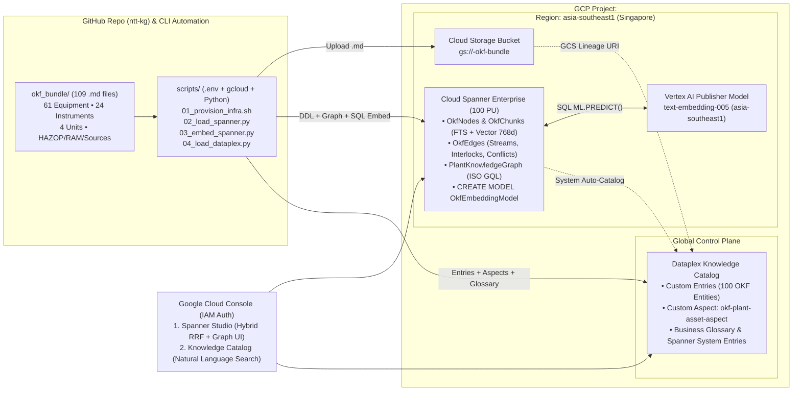

# NTT Plant Knowledge Graph & Knowledge Catalog Demo — System Architecture

- **Companion Interactive HTML/SVG Diagram:** [`docs/ntt-kg-demo-architecture.html`](./ntt-kg-demo-architecture.html)
- **GCP Project:** `<YOUR_GCP_PROJECT_ID>`
- **Primary Region:** `asia-southeast1` (Singapore) + Global Dataplex Universal Catalog Control Plane
- **GitHub Repository:** `https://github.com/pantana-na/ntt-kg.git`
- **Workload Mode:** `Regular App` (Data & Console Demo Automation Pipeline — Zero Custom UI)

---

## 1. Executive Architecture Summary

This demo showcases how Google Cloud turns an unstructured/semi-structured industrial engineering corpus (**`okf_bundle/` — Open Knowledge Format v0.2** for Seabrook Station P&IDs, Safety Interlocks, and IEC 61882 HAZOP Standards) into an enterprise **Multi-Model Knowledge Graph & Governed Knowledge Catalog** experienced **100% natively in the Google Cloud Console**:

1. **Cloud Spanner (`asia-southeast1`, Enterprise Edition, `100 PU`):**
   - **Native In-Database Embeddings (`CREATE MODEL` + `ML.PREDICT`):** Spanner directly invokes Vertex AI `text-embedding-005` in `asia-southeast1` inside SQL—both during ingestion backfill and live at query time in Spanner Studio—eliminating external embedding middleware.
   - **Full-Text Keyword Search (`TOKENLIST` + `SEARCH INDEX`):** Delivers exact token/tag recall on P&ID equipment tags (`1-SS-E-14A`, `RH-E-9A`, `CS-P-2A`), instrument tags (`FIS-610`, `RE-6510`), and NRC drawing numbers (`PID-1-SI-LR20448`).
   - **Vector Search (`ARRAY<FLOAT32>(vector_length=>768)` + `COSINE_DISTANCE`):** Captures conceptual engineering hazards and symptoms (e.g., *"prevent charging pump deadheading overheating"* or *"radioactive tube leak detection"*) even when exact keywords differ.
   - **Hybrid Search with Reciprocal Rank Fusion (RRF):** Combines Full-Text Search rank and Vector Search rank into a single unified SQL score (`1 / (60 + fts_rank) + 1 / (60 + vec_rank)`), outperforming either retrieval mode alone.
   - **Spanner Graph (`CREATE PROPERTY GRAPH PlantKnowledgeGraph` + ISO GQL):** Models all 100 OKF entities as graph nodes and 600+ P&ID stream connections, instrument interlocks, unit memberships, source citations, and cross-drawing conflicts (`⚠️ CONFLICT`) as directed edges—queryable and visually interactive inside **Spanner Studio**.
2. **Dataplex Knowledge Catalog (Universal Catalog — Global Natural Language Search):**
   - Mirrors `okf_bundle/` Markdown files to Cloud Storage (`gs://<YOUR_GCP_PROJECT_ID>-okf-bundle`), registers a **Custom Entry Group** (`okf_plant_knowledge`) with **100 rich Custom Entries**, attaches typed **Custom Aspects** (`okf_plant_asset_aspect` capturing `unit`, `entity_type`, `equipment_class`, `safety_classification`, `has_conflict`, `pid_drawing`, `governing_standard`, and `gcs_uri`), seeds a **Business Glossary**, and automatically catalogs the Spanner database tables/graph—unlocking **Natural Language Search** and hybrid aspect filtering in the Google Cloud Console.

---

## 2. End-to-End Topology

---

## 3. `okf_bundle` Corpus Assessment & Data Mapping

| OKF Category (`okf_bundle/`) | File Count | Domain Entities (`YAML Frontmatter`) | Spanner Relational / Vector / FTS Mapping | Spanner Graph (`PlantKnowledgeGraph`) | Dataplex Knowledge Catalog Mapping |
| :--- | :---: | :---: | :--- | :--- | :--- |
| **`equipment/`** | 62 (`61` entities + `index.md`) | `Equipment Concept` (`tag`, `equipment_class`, `unit`, `instruments`, `connections`) | `OkfNodes` (`node_type='EQUIPMENT'`) + section-chunked `OkfChunks` (`TOKENLIST` + `ARRAY<FLOAT32>(768)`) | Node `OkfNodes` + `288` `CONNECTS_STREAM` edges + `210` `HAS_INSTRUMENT` edges + `HAS_CONFLICT` flags | Custom Entry (`okf-equipment`) + `okf-plant-asset-aspect` (`unit`, `equipment_class`, `safety_class`, `has_conflict`) |
| **`instruments/`** | 25 (`24` entities + `index.md`) | `Instrument Specification` (`tag`, `instrument_type`, `safety_classification`, `service`, `location`) | `OkfNodes` (`node_type='INSTRUMENT'`) + `OkfChunks` (captures `⚠️ CRITICAL PROCESS SAFETY` warnings & interlocks) | Node `OkfNodes` + `MONITORS_EQUIPMENT` / `CONTROLS_INTERLOCK` edges | Custom Entry (`okf-instrument`) + `okf-plant-asset-aspect` (`instrument_type`, `safety_class`, `interlock`) |
| **`units/`** | 5 (`4` entities + `index.md`) | `Unit Overview` (`SI`, `SW`/`SWA`, `SF`, `SS`) | `OkfNodes` (`node_type='UNIT'`) + `OkfChunks` | Node `OkfNodes` + `BELONGS_TO_UNIT` edges from Equipment & Instruments | Custom Entry (`okf-unit`) + `okf-plant-asset-aspect` (`facility='Seabrook Station'`, `unit_code`) |
| **`hazop/`**, **`procedures/`**, **`standards/`** | 9 (`6` entities + `3` `index.md`) | `HAZOP Protocol`, `Risk Assessment Protocol`, `Standard Operating Procedure`, `Workflow Procedure`, `Engineering Standard` | `OkfNodes` (`node_type` per protocol/standard) + `OkfChunks` (IEC 61882 guide words, RAM matrix) | Node `OkfNodes` + `GOVERNED_BY_STANDARD` edges | Custom Entries + `okf-plant-asset-aspect` (`governing_standard='IEC 61882'`) + Business Glossary terms |
| **`sources/`** | 6 (`5` entities + `index.md`) | `Source Document` (`ML101620329` Parts 1–3, `HAZOP_Training_Guide.pdf`, `RAM`) | `OkfNodes` (`node_type='SOURCE_DOCUMENT'`) + `OkfChunks` | Node `OkfNodes` + `106` `EXTRACTED_FROM` provenance edges | Custom Entry (`okf-source-doc`) + P&ID drawing list metadata |
| **Root (`index.md`, `log.md`)** | 2 | Master Catalog Index & Lineage Log | Indexed in `OkfChunks` for corpus-level summary queries | Provenance metadata | Mirrored in GCS bucket `gs://<YOUR_GCP_PROJECT_ID>-okf-bundle` |

---

## 4. Pragmatic WAF Alignment (Demo-Scoped)

While intentionally streamlined for a low-ceremony Google Cloud Console PoC (no Cloud Run web UI, Load Balancer, VPC-SC, or CMEK), the architecture preserves core **Google Cloud Well-Architected Framework** fundamentals:
- **Security (IAM-Only Zero Public Exposure):** Zero public endpoints or `allUsers` bindings; all access runs through authenticated Google Cloud Console IAM, and Spanner invokes Vertex AI via the Google-managed Spanner Service Agent (`service-<PROJECT_NUMBER>@gcp-sa-spanner.iam.gserviceaccount.com` with `roles/aiplatform.user`).
- **Cost Optimization:** Spanner Enterprise provisioned at the minimum **`100 Processing Units`** (`0.1` node) in `asia-southeast1` with a 1-command `99_teardown.sh` script to eliminate idle PoC spend immediately after the demo.
- **Performance & Co-Location:** Cloud Storage, Spanner, and Vertex AI `text-embedding-005` are co-located in `asia-southeast1` for low-latency `ML.PREDICT` embedding calls during live Spanner Studio queries.
