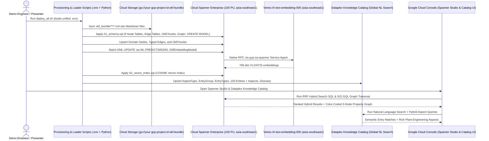

# Enterprise Solution Design & Specification: NTT Plant Knowledge Graph & Knowledge Catalog Console Demo

## Document Control

| Field | Value |
| :--- | :--- |
| **Spec ID** | `SPEC-20261116-NTT-KG-DEMO` |
| **Workload Type** | `Regular App` |
| **Status** | `Implemented` |
| **Author** | `Principal Cloud Data & AI Systems Architect` |
| **Date** | `2026-11-16` |
| **Version** | `1.1` |
| **Discovery Reference** | `N/A` |
| **Baseline Reference** | `N/A (Greenfield)` |

---

## 1. Executive Summary & Problem Framing

### 1.1 Business Context & Problem Statement
- **Context & Motivation:** Industrial and nuclear/process engineering organizations maintain dense engineering documentation—P&IDs, equipment specifications, safety interlock sheets, IEC 61882 HAZOP protocols, and Risk Assessment Matrices—where critical operational relationships and safety discrepancies (`⚠️ CONFLICT`) span dozens of cross-referenced files. In this engagement (`ntt-kg`), we have an **Open Knowledge Format (OKF v0.2)** bundle (`okf_bundle/` — 109 Markdown files, 100 structured YAML-frontmatter entities, 288 P&ID stream connections, and 210 inline instrument bindings) that needs to be operationalized into a live Google Cloud demonstration without building or maintaining a custom frontend UI.
- **Target Personas:** Customer Engineers, Solution Architects, Data & Knowledge Engineers, and Process Safety Stakeholders interacting directly through the **Google Cloud Console** (**Spanner Studio** and **Dataplex Knowledge Catalog Search**).
- **Goals:**
  1. Assess and parse `okf_bundle/` deterministically into 5 domain node tables (`PlantUnits`, `Equipment`, `Instruments`, `ProcessBoundaries`, `GovernanceDocs`), 5 typed relationship edge labels (`BELONGS_TO_UNIT`, `FLOWS_TO`, `MONITORS`, `EXTRACTED_FROM`, `GOVERNED_BY`), section-level semantic chunks (`OkfChunks`), and rich catalog governance metadata.
  2. Provision and seed **Google Cloud Spanner Enterprise (`100 PU`, `asia-southeast1`)** in project `your-gcp-project-id` with **Spanner Native Embeddings** (`CREATE MODEL` + `ML.PREDICT` over Vertex AI `text-embedding-005`), **Full-Text Keyword Search** (`TOKENLIST` + `SEARCH INDEX`), **Vector Search** (`ARRAY<FLOAT32>(vector_length=>768)` + `VECTOR INDEX` / `COSINE_DISTANCE`), **Reciprocal Rank Fusion (RRF) Hybrid Search**, and **Spanner Graph** (`CREATE PROPERTY GRAPH PlantKnowledgeGraph` + ISO **GQL**).
  3. Provision and seed **Dataplex Knowledge Catalog (Universal Catalog)** with raw Markdown lineage in Cloud Storage (`gs://your-gcp-project-id-okf-bundle`), a Custom Entry Group, **100 Custom Entries**, a Custom Aspect Type (`okf-plant-asset-aspect`), a Plant/HAZOP **Business Glossary**, and system-cataloged Spanner tables to demonstrate **Natural Language Search** and hybrid aspect filtering.
  4. Deliver a unified `.env` (and `.env.example`), automated CLI/Python deployment & teardown scripts, unit + property-based tests (`hypothesis`), and a polished **Executive Demo Intro + Step-by-Step Live Console Demo Script**.

### 1.2 Scope Definition & Operational Boundaries
- **In-Scope Automated Capabilities (Universal):**
  - Deterministic YAML frontmatter + Markdown parser (`src/okf_kg/parser.py`) extracting all 100 domain entities, inline P&ID instruments, synthesized `ProcessBoundaries`, section chunks, resolved equipment-to-equipment and boundary stream connections, safety interlocks, source provenance, and `⚠️ CONFLICT` discrepancy warnings.
  - Idempotent Bash + Python provisioning and ingestion scripts (`scripts/01_provision_infra.sh`, `scripts/02_load_spanner.py`, `scripts/03_embed_spanner.py`, `scripts/04_load_dataplex.py`, `scripts/05_verify_demo.py`, `scripts/deploy_all.sh`, `scripts/99_teardown.sh`).
  - Pre-built SQL, RRF Hybrid Search, and ISO GQL query library (`sql/01_schema.sql`, `sql/02_vector_index.sql`, `sql/demo_queries_spanner.sql`) plus live Dataplex Natural Language Search playbook (`docs/DEMO_SCRIPT_AND_INTRO.md`).
- **Human-Gated / Role-Approved Capabilities (Universal):**
  - Authenticated Google Cloud Console IAM access (`roles/spanner.databaseUser`, `roles/dataplex.catalogViewer`) to execute live Console queries; explicit confirmation flag before running `scripts/99_teardown.sh`.
- **Explicit Non-Goals (Out-of-Scope):**
  - Custom React/Vite web UI or Cloud Run microservices (`N/A` — Google Cloud Console is the sole presentation layer).
  - Conversational ADK agents (`[AI-Agent Only]` sections marked `N/A — Regular App`).
  - Heavy production perimeter controls (Global External ALB, Cloud Armor, VPC-SC, CMEK) intentionally omitted per stakeholder PoC/demo directive, while preserving IAM-only zero-public-access hygiene and documenting the demo vs. production blueprint in Section 3 & Section 7 ADRs.

### 1.3 Workload-Specific Acceptance Criteria & SLAs
- **Universal Operational SLAs (WAF Pillars 3 & 5 — PoC Demo Targets):**
  - **Composite Availability SLO & Error Budget:** `99.9%` monthly regional Spanner Enterprise SLA (`43.2m` monthly error budget; single-region `asia-southeast1` demo deployment).
  - **Console Query Latency & Ingestion Throughput:** Spanner Full-Text / Vector / RRF Hybrid Search `p95 <= 800ms` (including inline `ML.PREDICT` single-query embedding call in `asia-southeast1`, `p99 <= 1500ms`); Spanner Graph 1-to-4 hop GQL traversal `p95 <= 400ms`; full `okf_bundle` end-to-end ingestion & embedding backfill `<= 5 minutes`.
  - **Recovery Objectives:** `RTO: <= 15m` (re-runnable idempotent provisioning + seed pipeline from Git/GCS) | `RPO: 0m` (canonical `okf_bundle/` source-controlled in GitHub `https://github.com/pantana-na/ntt-kg.git` and mirrored to GCS).
- **`[AI-Agent Only]` Agentic Quality & Streaming SLAs:** `N/A — Regular App (Console Data & Search Demo)`.

---

## 2. System Architecture, Topology & Code Contracts

### 2.1 Architecture Diagram
- Companion interactive visual diagram: [`docs/ntt-kg-demo-architecture.html`](../../docs/ntt-kg-demo-architecture.html) and [`docs/ntt-kg-demo-architecture.md`](../../docs/ntt-kg-demo-architecture.md).



### 2.2 Service Interaction Flow
- **Ingestion & Provisioning Flow:**
  1. `scripts/01_provision_infra.sh` enables required GCP APIs (`spanner.googleapis.com`, `dataplex.googleapis.com`, `aiplatform.googleapis.com`, `storage.googleapis.com`), creates the regional GCS bucket in `asia-southeast1`, syncs `okf_bundle/`, provisions Spanner Enterprise instance `ntt-kg-demo` (`100 PU`) + database `plant-kg`, triggers the Spanner Service Agent identity (`gcloud beta services identity create --service=spanner.googleapis.com`), grants `roles/aiplatform.user` to `service-<PROJECT_NUMBER>@gcp-sa-spanner.iam.gserviceaccount.com`, and applies `sql/01_schema.sql`.
  2. `scripts/02_load_spanner.py` parses `okf_bundle/` into the 5 domain node tables (`PlantUnits`, `Equipment`, `Instruments`, `ProcessBoundaries`, `GovernanceDocs`), typed edge tables (`BELONGS_TO_UNIT`, `FLOWS_TO`, `MONITORS`, `EXTRACTED_FROM`, `GOVERNED_BY`), and `OkfChunks` using idempotent `insert_or_update` mutations.
  3. `scripts/03_embed_spanner.py` executes batched SQL DML `UPDATE` statements inside Spanner calling `ML.PREDICT(MODEL OkfEmbeddingModel, ...)` natively so embeddings are generated directly by Spanner's Vertex AI integration with exponential backoff retry handling, then applies `sql/02_vector_index.sql`.
  4. `scripts/04_load_dataplex.py` creates/updates the Custom Aspect Type `okf-plant-asset-aspect`, Custom Entry Group `okf-plant-knowledge`, Custom Entry Type `okf-knowledge-asset`, all **100 Custom Entries** with rich descriptions, overviews, GCS links, and structured Aspects, plus a Plant Engineering & HAZOP **Business Glossary**.
- **`[AI-Agent Only]` Agent Topology & Orchestration Flow:** `N/A — Regular App`.

### 2.3 Compute Runtime & Google Cloud Well-Architected Framework (6 Pillars) Alignment

| Dimension | Provisioning & Demo Data Platform (`Regular App`) |
| :--- | :--- |
| **Target Runtime** | **Cloud Spanner Enterprise (`asia-southeast1`, `100 PU`)** + **Dataplex Knowledge Catalog (`global` / `asia-southeast1`)** + **Cloud Storage (`asia-southeast1`)**; presented via **Google Cloud Console** (no Cloud Run container required for demo; Terraform / Cloud Build blueprint documented for production promotion). |
| **Compute & Sizing** | Spanner Enterprise `100 Processing Units` (`0.1` node minimum footprint); local/Cloud Shell Python 3.11+ execution for one-time ingestion; co-located in `asia-southeast1` (`Low CO2` / regional proximity for SEA demos). |
| **Embedding Integration** | Spanner Native `CREATE MODEL OkfEmbeddingModel` pinned to `publishers/google/models/text-embedding-005` (`768` dimensions) in `asia-southeast1`. |

- **Google Cloud Well-Architected Framework (6 Pillars) Summary:**
  1. **Operational Excellence:** Automated idempotent provisioning/verification (`scripts/05_verify_demo.py`), structured JSON/CLI logging correlated with Cloud Logging & Cloud Monitoring metrics, explicit SLIs/SLOs & error budgets, and reproducible IaC/CLI automation (with Terraform/Infrastructure Manager path documented for prod).
  2. **Security, Privacy, and Compliance:** Zero-Trust Google Cloud Console IAM access (zero `allUsers` or public endpoints; organization policy compliant); least-privilege Spanner Service Agent (`roles/aiplatform.user`) for Vertex AI model calls; unified `.env` configuration with zero hardcoded secrets; production architecture path supports IAP / OAuth 2.0, Cloud Armor, VPC Service Controls (`VPC-SC`), Private Service Connect, and Cloud KMS (`CMEK`).
  3. **Reliability:** Regional Spanner Enterprise (`99.9%` SLA, `RTO <= 15m`, `RPO = 0m`), idempotent `insert_or_update` batch writes, bounded RPC timeouts, circuit-breaker / exponential backoff + jitter on Vertex AI `ML.PREDICT` embedding batches and Dataplex API calls, and graceful degradation (falling back cleanly to Full-Text Search if Vertex AI quota is throttled, never fabricating fake records).
  4. **Cost Optimization (FinOps):** Right-sized `100 PU` Spanner Enterprise (`~$0.09/hr` compute footprint), scale-to-zero CLI ingestion, mandatory FinOps resource labels (`env=demo`, `service=ntt-kg-demo`, `owner=ce-team`, `cost_center=poc`), BigQuery billing export / budget alerts support, Committed Use Discounts (CUDs) guidance for steady-state prod, and 1-command `99_teardown.sh` cleanup.
  5. **Performance Optimization:** Co-location of GCS, Spanner, and Vertex AI `text-embedding-005` in `asia-southeast1` minimizing network RTT (`p95 <= 800ms`), `TOKENLIST` inverted `SEARCH INDEX`, ScaNN `VECTOR INDEX`, connection pooling via `google-cloud-spanner` session pool, and single-query SQL RRF fusion.
  6. **Sustainability (GreenOps):** Low-carbon footprint via minimum `100 PU` compute sizing, zero idle frontend servers (scale-to-zero serverless Console consumption), GCS lifecycle TTL rules option for temporary staging artifacts, CFE % region tracking, and Carbon Footprint export compatibility.

### 2.4 Data Models, Multi-Table Domain Graph DDL & Catalog Contracts

#### 2.4.1 Python Domain Models (`src/okf_kg/models.py`)
```python
from dataclasses import dataclass, field
from typing import Any, Dict, List, Optional


@dataclass(frozen=True)
class PlantUnitNode:
    unit_id: str                 # e.g. "UNIT:SI", "UNIT:SW", "UNIT:SF", "UNIT:SS"
    unit_code: str
    title: str
    facility: str
    safety_classification: Optional[str]
    description: str
    has_warning: bool
    gcs_uri: Optional[str]


@dataclass(frozen=True)
class EquipmentNode:
    equipment_id: str            # e.g. "EQ:RH-E-9A", "EQ:1-SS-E-14A"
    tag: str
    title: str
    equipment_class: str
    unit_code: str
    safety_classification: Optional[str]
    has_conflict: bool
    conflict_summary: Optional[str]
    description: str
    gcs_uri: str


@dataclass(frozen=True)
class InstrumentNode:
    instrument_id: str           # e.g. "INST:FIS-610", "INST:TI-2785"
    tag: str
    title: str
    instrument_type: str
    unit_code: Optional[str]
    safety_classification: Optional[str]
    location: Optional[str]
    setpoint_or_range: Optional[str]
    interlock_or_alarm: Optional[str]
    has_warning: bool
    is_full_spec: bool
    description: str
    gcs_uri: Optional[str]


@dataclass(frozen=True)
class ProcessBoundaryNode:
    boundary_id: str             # e.g. "BND:CCW-LOOP-A-SUP", "BND:SB-SG1-BLOWDOWN"
    tag: str
    boundary_type: str           # HEADER | PENETRATION | SUMP_FLOOR | UTILITY | EXTERNAL
    description: str


@dataclass(frozen=True)
class GovernanceDocNode:
    doc_id: str                  # e.g. "DOC:hazop/guide-words-and-deviations"
    doc_type: str                # HAZOP Protocol | Risk Assessment Protocol | Engineering Standard | SOP | Workflow Procedure | Source Document
    tag: str
    title: str
    governing_standard: Optional[str]
    has_warning: bool
    description: str
    gcs_uri: str


@dataclass(frozen=True)
class OkfChunkRecord:
    chunk_id: str                # e.g. "EQ:RH-E-9A#sec-0"
    entity_id: str               # Matches Graph Node PK (EquipmentId, InstrumentId, UnitId, or DocId)
    entity_label: str            # Equipment | Instrument | PlantUnit | GovernanceDoc
    chunk_index: int
    section_heading: str
    tag: str
    title: str
    unit_code: Optional[str]
    safety_classification: Optional[str]
    has_conflict: bool
    gcs_uri: str
    chunk_text: str              # Context-enriched header + section markdown
```

#### 2.4.2 Cloud Spanner Multi-Table Domain Graph & Hybrid Search DDL (`sql/01_schema.sql` & `sql/02_vector_index.sql`)
1. **Spanner Native Embedding Model (`OkfEmbeddingModel`):** Calls `//aiplatform.googleapis.com/projects/${GCP_PROJECT}/locations/${GCP_REGION}/publishers/google/models/${EMBEDDING_MODEL}` (`text-embedding-005`, `768` dimensions).
2. **5 Domain Node Tables (`PlantUnits`, `Equipment`, `Instruments`, `ProcessBoundaries`, `GovernanceDocs`):** Give **Spanner Studio Schema View** and **Graph View** 5 distinct color-coded node labels (`PlantUnit`, `Equipment`, `Instrument`, `ProcessBoundary`, `GovernanceDoc`).
3. **Typed Relationship Edge Tables:**
   - `UnitEquipment` $\rightarrow$ `LABEL BELONGS_TO_UNIT` (`Equipment` $\rightarrow$ `PlantUnit`)
   - `EquipmentFlows` (`Equipment` $\rightarrow$ `Equipment`), `BoundaryToEquipmentFlows` (`ProcessBoundary` $\rightarrow$ `Equipment`), and `EquipmentToBoundaryFlows` (`Equipment` $\rightarrow$ `ProcessBoundary`) $\rightarrow$ unified `LABEL FLOWS_TO` with identical stream properties (`StreamId`, `Direction`, `LineSize`, `InlineComponents`, `Temperature`, `Pressure`, `SourceDrawing`, `Description`) so multi-hop GQL `-[:FLOWS_TO]->{1,4}` traverses seamlessly across equipment and shared headers.
   - `InstrumentMonitorsEquipment` $\rightarrow$ `LABEL MONITORS` (`Instrument` $\rightarrow$ `Equipment`, storing `LoopRole`, `Location`, `SetpointOrRange`, `InterlockOrAlarm`, `SourceDrawing`)
   - `EquipmentDocumentLineage`, `InstrumentDocumentLineage`, `UnitDocumentLineage` $\rightarrow$ unified `LABEL EXTRACTED_FROM` (`*` $\rightarrow$ `GovernanceDoc`)
   - `EquipmentSafetyGovernance`, `InstrumentSafetyGovernance` $\rightarrow$ unified `LABEL GOVERNED_BY` (`*` $\rightarrow$ `GovernanceDoc`)
4. **Unified Hybrid Search Corpus (`OkfChunks`):**
   - Stores section-chunked Markdown across all 100 entities + root index/logs with `ChunkTokens TOKENLIST AS (TOKENIZE_FULLTEXT(ChunkText)) HIDDEN`, `CREATE SEARCH INDEX OkfChunksSearchIdx`, `Embedding ARRAY<FLOAT32>(vector_length => 768)`, and post-backfill `CREATE VECTOR INDEX OkfChunksEmbeddingIdx ... WHERE Embedding IS NOT NULL OPTIONS (distance_type = 'COSINE')`.
   - Joins directly to `PlantKnowledgeGraph` via `EntityId` / `Tag` in combined SQL + `GRAPH_TABLE(...)` hybrid GraphRAG queries.

#### 2.4.3 Dataplex Knowledge Catalog Contracts
- **Custom Aspect Type:** `projects/${GCP_PROJECT}/locations/${DATAPLEX_LOCATION}/aspectTypes/okf-plant-asset-aspect`
  - Record fields:
    1. `entity_type` (`string`, required): e.g., `Equipment Concept`, `Instrument Specification`, `Unit Overview`, `HAZOP Protocol`
    2. `tag` (`string`, required): e.g., `1-SS-E-14A`, `FIS-610`, `RH-E-9A`
    3. `unit_code` (`string`, optional): e.g., `SI`, `RH / SI`, `SW`, `SF`, `SS`
    4. `equipment_or_instrument_class` (`string`, optional): e.g., `Heat Exchanger`, `Pump`, `Flow Indicating Switch`
    5. `safety_classification` (`string`, optional): e.g., `Safety Class 2`, `Safety Class NNS`
    6. `has_discrepancy_warning` (`bool`, required): `true` when `⚠️ CONFLICT` or `CRITICAL PROCESS SAFETY / DISCREPANCY WARNING` is present
    7. `governing_standard_or_drawing` (`string`, optional): e.g., `PID-1-SI-LR20448`, `IEC 61882`
    8. `gcs_markdown_uri` (`string`, optional): `gs://your-gcp-project-id-okf-bundle/okf_bundle/...`
    9. `spanner_node_id` (`string`, required): `EQUIPMENT:1-SS-E-14A`
- **Custom Entry Group & Entry Type:**
  - Entry Group: `projects/${GCP_PROJECT}/locations/${GCP_REGION}/entryGroups/okf-plant-knowledge`
  - Entry Type: `projects/${GCP_PROJECT}/locations/${GCP_REGION}/entryTypes/okf-knowledge-asset`
  - Entries: 100 governed entries (`entry_source.display_name`, `entry_source.description`, `entry_source.system = "Open Knowledge Format (OKF v0.2)"`, `entry_source.location = gcs_uri`, rich Markdown overview aspect where supported + `okf-plant-asset-aspect`).
- **Business Glossary:** `projects/${GCP_PROJECT}/locations/global/glossaries/okf-plant-glossary` containing canonical nuclear/process engineering terms (`Safety Injection`, `Residual Heat Removal`, `HAZOP Guide Words`, `Risk Assessment Code`, `Reciprocal Rank Fusion`, `Containment Recirculation Sump`).
- **Error & Degraded-Mode Contracts:** CLI exit codes (`0` = success, `2` = configuration/validation error, `3` = `UPSTREAM_UNAVAILABLE_DEGRADED` when Vertex AI/Spanner/Dataplex RPCs remain unreachable after bounded retries, emitting structured JSON diagnostics with zero fabricated records).

---

## 3. Security, Privacy, Compliance & Governance Alignment

### 3.1 Input/Output Guardrails & Injection Defenses
- **Application & Ingestion Defenses:** Strict schema validation across all parsed YAML frontmatter and Markdown sections; parameterized GoogleSQL queries (`@query_text`, `@node_id`) and typed Spanner Mutation APIs preventing SQL/GQL injection; zero untrusted user web inputs (`Regular App` Console-only PoC).
- **`[AI-Agent Only]` 4-Point Inline Model Armor + Cloud DLP Callbacks:** `N/A — Regular App`.

### 3.2 Identity Delegation, Authorization & Execution Sandboxing
- **Zero-Trust IAM & Console Access (Rule 10):**
  - Zero public endpoints, zero `allUsers`, and zero `allAuthenticatedUsers` IAM bindings (strictly compliant with `constraints/iam.allowedPolicyMemberDomains`).
  - Human demo operators authenticate via Google Cloud Console IAM (`OAuth 2.0` session). If a web UI were ever added in production, it would enforce **Pattern 1A (ALB + Cloud Armor + Identity-Aware Proxy [IAP])** or **Pattern 1B (Direct Cloud Run IAP + `x-goog-iap-jwt-assertion` verification)**.
  - Spanner invokes Vertex AI `text-embedding-005` exclusively through the Google-managed Spanner Service Agent (`service-${PROJECT_NUMBER}@gcp-sa-spanner.iam.gserviceaccount.com`) granted least-privilege `roles/aiplatform.user` (zero exported JSON service account keys).

### 3.3 Network Security, Perimeter & Unified `.env` Configuration
- **Configuration Hygiene (Rule 8):** Single unified `.env` (gitignored) and `.env.example` containing Shared Core (`GCP_PROJECT=your-gcp-project-id`, `GCP_REGION=asia-southeast1`, `DATAPLEX_LOCATION=asia-southeast1`, `EMBEDDING_MODEL=text-embedding-005`, `GITHUB_REPO=https://github.com/pantana-na/ntt-kg.git`), `NONPROD_*` (PoC/Demo `100 PU` Spanner instance `ntt-kg-demo`), and `PROD_*` (`1000 PU` production template) blocks.
- **Enterprise Production Upgrade Path:** While VPC Service Controls (`VPC-SC`), Private Service Connect, and Cloud KMS (`CMEK`) are omitted in the lightweight PoC scripts per user instruction, all resource names and region settings (`asia-southeast1`) are structured so `VPC-SC` and `CMEK` can be wrapped around Spanner, GCS, Vertex AI, and Dataplex without schema changes.

### 3.4 Governance Checklist (Rules 1–13)
| Rule / Framework | Applicability | PoC Demo Implementation |
| :--- | :--- | :--- |
| **Google Cloud WAF (6 Pillars)** | **Universal** | Right-sized `100 PU` Spanner Enterprise in `asia-southeast1`, IAM-only access, idempotent retries, FinOps labels + teardown script. |
| **Rules 1–2 (Git SCM & Static Quality)** | **Universal** | Tracked in `https://github.com/pantana-na/ntt-kg.git` (`main` branch), Python type annotations + syntax/lint validation. |
| **Rule 8 (Unified `.env`)** | **Universal** | `.env` + `.env.example` with Shared Core, `NONPROD_*` (active demo), and `PROD_*` blocks; `.env` excluded in `.gitignore`. |
| **Rule 10 (Zero-Trust IAM)** | **Universal** | Console IAM only; zero `allUsers` or public buckets/endpoints. |
| **Rule 13 (4-Step RCA & Graceful Degradation)** | **Universal** | Mandatory 4-Step RCA on any test/script failure; bounded retries with exponential backoff + jitter; zero synthetic fallback data. |
| **Rules 11–12 (`google-adk` & SAIF 2.0)** | **`[AI-Agent Only]`** | `N/A — Regular App`. |

---

## 4. Resiliency, Reliability & State Integrity

### 4.1 Execution Boundaries & Rate Limits
- **Bounded RPC Timeouts & Batching:** Spanner DDL operations bounded to `600s`; Spanner DML `ML.PREDICT` updates batched at `20` rows per transaction (well within Vertex AI `text-embedding-005` online prediction RPM/TPM quotas in `asia-southeast1`) with `60s` per-batch timeout; Dataplex entry upserts bounded to `30s` per RPC.

### 4.2 Idempotency & Transactional Consistency
- **Deterministic Keys & Idempotent Re-Runs:** Node IDs (`<TYPE>:<TAG>`), Chunk IDs (`<NODE_ID>#sec-<N>`), Edge IDs (deterministic SHA-256 digest of `src|edge_type|dst|stream_id`), and Dataplex Entry IDs (sanitized lowercase slug) are 100% deterministic. Re-running `02_load_spanner.py`, `03_embed_spanner.py` (`WHERE Embedding IS NULL`), or `04_load_dataplex.py` (`create` or `update_entry`) produces zero duplicate records.

### 4.3 High Availability & WAF Graceful Degradation
- **Retries & Circuit Breaking:** Python ingestion and verification utilities implement exponential backoff with jitter (`1s`, `2s`, `4s`, `8s`, `16s`) on `429 ResourceExhausted` and `503 ServiceUnavailable`. If Vertex AI embedding generation hits hard quota exhaustion after retries, `03_embed_spanner.py` halts cleanly with `status: "UPSTREAM_UNAVAILABLE_DEGRADED"` preserving already-committed embeddings so the next run resumes solely on remaining `WHERE Embedding IS NULL` rows—never inserting random/zero placeholder vectors.

---

## 5. Observability & Operations

### 5.1 Health Verification & Operational Telemetry
- **Automated Readiness Verifier (`scripts/05_verify_demo.py`):** Acts as the end-to-end operational readiness probe verifying: (1) Spanner `OkfNodes`, `OkfEdges`, and `OkfChunks` counts & `0` null embeddings, (2) live Spanner RRF Hybrid Search query execution, (3) live Spanner Graph `PlantKnowledgeGraph` GQL query execution, and (4) live Dataplex Knowledge Catalog `search_entries` discovery.
- **Cloud Monitoring & Logging:** Spanner CPU, storage, and Vertex AI `ML.PREDICT` latency metrics automatically emit to Cloud Monitoring (`spanner.googleapis.com/*`, `aiplatform.googleapis.com/*`), with structured JSON CLI logs emitted during ingestion.

### 5.2 Structured Logging & Auditability
- Every script logs structured JSON/timestamped status records (`step`, `project`, `region`, `entity_count`, `duration_ms`, `status`) with zero credentials logged; GCP Admin Activity Audit Logs automatically record Spanner DDL and Dataplex Catalog mutations.

### 5.3 Automated Testing Gates
- **Deterministic Unit Tests (`tests/unit/`):** Verify YAML frontmatter extraction, Markdown section chunking, external P&ID node synthesis (ensuring zero dangling foreign keys in `OkfEdges`), conflict detection (`⚠️ CONFLICT`), `.env` loader parsing, and Dataplex entry ID slug rules.
- **Generative Property-Based Tests (`tests/property/` via `hypothesis`):** Verify mathematical invariants across randomized/fuzzed Markdown documents, entity tags, P&ID connection graphs, Reciprocal Rank Fusion (`RRF`) score monotonicity/bounds, and Dataplex entry slug compliance (`[a-z0-9_-]{1,63}`).

---

## 6. Performance Optimization, FinOps & Sustainability

### 6.1 Latency Engineering & Co-Location
- **Single-Region Co-Location (`asia-southeast1`):** Placing the GCS bucket, Spanner Enterprise instance, Spanner `OkfEmbeddingModel` endpoint, and Dataplex Entry Group all in `asia-southeast1` eliminates cross-continental hops during live `ML.PREDICT` hybrid queries (`p95 <= 800ms`) and keeps connection pooling warm in Spanner Studio.

### 6.2 Unit-Cost Modeling, FinOps & Sustainability (`GreenOps`)
- **Unit Economics KPI:** `~$2.16 / demo day` (`100 PU` Spanner Enterprise in `asia-southeast1` + negligible `< $0.05` one-time `text-embedding-005` token cost for ~100K tokens across 109 files + `< $0.02` GCS/Dataplex metadata storage), dropping to **`$0.00 / day`** once `scripts/99_teardown.sh` is run post-demo; production steady-state workloads can apply 1-year/3-year Spanner Committed Use Discounts (CUDs) and BigQuery billing export budget alerts.
- **FinOps Labels:** `env=demo`, `service=ntt-kg-demo`, `owner=ntt-poc`, `cost_center=demo` applied to GCS bucket and Spanner instance.
- **Sustainability (`GreenOps`):** Minimal `100 PU` compute allocation (`90%` smaller compute slice than a 1-node instance), zero always-on web/proxy VMs (scale-to-zero CLI + shared Google Cloud Console), and GCS lifecycle TTL support (`30`-day optional rule for temporary staging exports) aligned with Google Cloud Carbon Footprint reporting.

---

## 7. Architectural Decision Records (ADRs)

| ADR ID | Competing WAF Pillars / Constraints | Architectural Tension | Selected Resolution & Justification |
| :--- | :--- | :--- | :--- |
| **ADR-01** | **Performance & Simplicity** vs. **Custom Pipeline Flexibility** | Generating embeddings externally in Python vs. natively inside Cloud Spanner SQL (`CREATE MODEL` + `ML.PREDICT`). | **Spanner Native Embeddings (`CREATE MODEL OkfEmbeddingModel`):** Allows live ad-hoc natural language queries directly inside Spanner Studio SQL without any Python middleware or UI. |
| **ADR-02** | **Cost Optimization & Demo Velocity** vs. **Reliability / Enterprise Perimeter** | Multi-node HA + Cloud Run UI + VPC-SC/CMEK vs. lightweight Console-only PoC budget & fast setup. | **`100 PU` Spanner Enterprise + GCP Console UI:** Delivers full Spanner Graph, Vector, FTS, and Dataplex NL Search capabilities at `0.1` node cost with zero frontend maintenance. |
| **ADR-03** | **Latency (`asia-southeast1`)** vs. **Global Metadata Discovery** | Regional data co-location in Singapore vs. global Knowledge Catalog searchability. | **Co-locate GCS, Spanner & Vertex AI in `asia-southeast1`** while registering Dataplex Custom Entries/Glossary for **Global Natural Language Search** in Knowledge Catalog. |

### ADR-01: Use Spanner Native `CREATE MODEL` & `ML.PREDICT` for Both Ingestion and Live Hybrid Search
- **Context & Options Considered:** Option A computes embeddings in Python via `vertexai` SDK before inserting into Spanner (preventing ad-hoc text queries in Spanner Studio without pasting 768 floats). Option B registers `OkfEmbeddingModel` (`text-embedding-005` in `asia-southeast1`) directly in Spanner DDL and uses SQL `ML.PREDICT`.
- **Decision & Consequences:** Selected **Option B**. Presenters can type plain English questions directly into Spanner Studio SQL for both Vector Search and RRF Hybrid Search, making the Console demo dramatically more compelling. Requires granting `roles/aiplatform.user` to the Spanner Service Agent in `01_provision_infra.sh`.

### ADR-02: Dual-Surface Google Cloud Console Demo (Spanner Studio + Dataplex Knowledge Catalog) Without Custom Web UI
- **Context & Options Considered:** Option A builds a custom React/FastAPI Cloud Run app. Option B uses Spanner Studio (SQL RRF + interactive Graph GQL visualization) and Dataplex Knowledge Catalog Search UI directly in Google Cloud Console.
- **Decision & Consequences:** Selected **Option B** per explicit stakeholder requirement. Zero UI code to maintain, zero ingress attack surface, and customers see authentic Google Cloud native experiences out of the box.

---

## 8. Failure Mode & Effects Analysis (FMEA)

| ID | Component / Flow | Failure Mode | Blast Radius & User Impact | Detection Signal | Automated Mitigation & WAF Graceful Degradation |
| :--- | :--- | :--- | :--- | :--- | :--- |
| **FMEA-01** | Spanner Service Agent $\rightarrow$ Vertex AI `ML.PREDICT` | Missing `roles/aiplatform.user` IAM binding or `429` RPM quota spike during backfill | Embedding `UPDATE` batch fails in `03_embed_spanner.py` | Spanner `PERMISSION_DENIED` / `RESOURCE_EXHAUSTED` error in CLI logs | `01_provision_infra.sh` pre-creates `gcp-sa-spanner` identity & binds `roles/aiplatform.user` with IAM propagation wait; `03_embed_spanner.py` batches 20 rows with exponential backoff + jitter and resumes `WHERE Embedding IS NULL`. |
| **FMEA-02** | `OkfEdges` Foreign Key Integrity | Equipment P&ID `connections` reference external boundary tags (e.g., `SB-SG1-BLOWDOWN`, `ATMOSPHERE`, `CCW-LOOP-A-SUP`) not having dedicated `.md` files | Spanner `FK_OkfEdges_Src` / `FK_OkfEdges_Dst` insert failure | Unit/PBT graph integrity check & Spanner FK constraint | `parser.py` automatically synthesizes typed `EXTERNAL_BOUNDARY` nodes in `OkfNodes` for every referenced P&ID boundary/utility endpoint so 100% of the 288 streams form a connected, valid Spanner Property Graph. |
| **FMEA-03** | Dataplex Knowledge Catalog Entry IDs | Uppercase characters or slashes in OKF tags (`1-SS-E-14A`, `RH / SI`) rejected by Dataplex `entry_id` regex | `InvalidArgument` on `create_entry` | Deterministic unit + Hypothesis PBT slug tests | Canonical slugifier normalizes `entry_id` to `[a-z0-9-]{1,63}` with collision-proof hash suffix if needed while preserving verbatim `1-SS-E-14A` in `display_name` and `okf-plant-asset-aspect.tag`. |

---

## 9. Step-by-Step Implementation Plan & Test Design

### Step 1: Unified `.env` Configuration & Core OKF Knowledge Graph Parser (`src/okf_kg/`)
- **Implementation:** Create `.env`, `.env.example`, `pyproject.toml` / `requirements.txt`, `src/okf_kg/config.py`, `src/okf_kg/models.py`, and `src/okf_kg/parser.py` to parse all 109 `okf_bundle` files into `OkfNodeRecord`, `OkfEdgeRecord` (including synthesized `EXTERNAL_BOUNDARY` nodes so zero edges dangle), `OkfChunkRecord`, and Dataplex catalog payloads; create RRF helper math (`src/okf_kg/rrf.py`).
- **Unit Tests (`tests/unit/test_parser_and_config.py`):** Verify exact entity counts (`100` frontmatter entities + external boundary nodes + `288` stream edges), conflict extraction on `RH-E-9A`/`RH-E-9B`, `.env` `NONPROD_*`/`PROD_*` parsing, and zero dangling edge references.
- **Property-Based Tests (`tests/property/test_kg_properties.py`):** `hypothesis` tests verifying: (a) deterministic node/edge/chunk IDs across arbitrary frontmatter inputs, (b) 100% referential integrity (`every edge src & dst exists in node set`), (c) Dataplex `entry_id` regex conformance across fuzzed industrial tags, and (d) Reciprocal Rank Fusion (`RRF`) score bounds, symmetry, and monotonicity.
- **Completion Criteria:** 100% unit and PBT pass rate against the real `okf_bundle/` and fuzzed inputs.

### Step 2: `[AI-Agent Only]` ADK Agent Architecture (`agent_runtime`)
- **`N/A — Regular App`** (Headless CLI pipeline + Google Cloud Console native interfaces).

### Step 3: Spanner DDL (`Vector + FTS + RRF + Graph`) & Ingestion/Embedding Scripts (`sql/` & `scripts/`)
- **Implementation:** Author `sql/01_schema.sql`, `sql/02_vector_index.sql`, `scripts/01_provision_infra.sh`, `scripts/02_load_spanner.py`, and `scripts/03_embed_spanner.py` (using Spanner native `ML.PREDICT` over `OkfEmbeddingModel` in `asia-southeast1` with retry/backoff).
- **Unit Tests (`tests/unit/test_spanner_sql_and_loader.py`):** Validate DDL template substitution (zero unresolved `${...}` variables), table/index/graph definitions, mutation batching (`<=Spanner mutation limit`), and `ML.PREDICT` batching logic.
- **Property-Based Tests (`tests/property/test_batching_properties.py`):** `hypothesis` tests verifying batch chunk partitioning preserves exact item order and cardinality (`sum(len(b) for b in batches) == len(items)`) and never exceeds Spanner's 80,000-cell mutation limit per commit.
- **Completion Criteria:** Validated DDL and loader modules with 100% passing unit and property tests.

### Step 4: Console Surface Enablement — Dataplex Knowledge Catalog Loader & Demo Query Suite (`N/A` Custom Web UI)
- **Implementation:** Author `scripts/04_load_dataplex.py` (creating/updating `okf-plant-asset-aspect`, `okf-plant-knowledge` Entry Group, `okf-knowledge-asset` Entry Type, 100 Entries with rich Aspects & GCS links, and Plant/HAZOP Business Glossary), `scripts/05_verify_demo.py`, `scripts/deploy_all.sh`, `scripts/99_teardown.sh`, and `sql/demo_queries_spanner.sql`.
- **Unit Tests (`tests/unit/test_dataplex_payloads.py`):** Verify every `OkfNodeRecord` maps cleanly to a valid Dataplex `Entry` + `Aspect` protobuf structure with required fields populated and boolean/string types matching `MetadataTemplate`.
- **Property-Based Tests (`tests/property/test_dataplex_properties.py`):** `hypothesis` tests verifying Aspect payload schema conformance and idempotent payload determinism across arbitrary `OkfNodeRecord` permutations.
- **Completion Criteria:** 100% unit and PBT pass rate across Dataplex catalog builders and CLI verification scripts.

### Step 5: Demo Intro, Live Google Cloud Console Demo Script & Quality/WAF Audit
- **Implementation:** Author `docs/DEMO_SCRIPT_AND_INTRO.md` (Executive pitch, architecture walkthrough, Act 1: Spanner Keyword vs. Vector vs. RRF Hybrid Search in Spanner Studio, Act 2: Spanner Graph GQL visual P&ID + Interlock + Conflict traversal, Act 3: Dataplex Knowledge Catalog Natural Language Search + Hybrid Aspect Filtering, plus speaker talk-track and expected outputs), update `README.md`, and run static quality + `validate_waf_saif.py` checks.
- **Unit Tests:** Automated test verifying every SQL/GQL query and demo entity tag referenced in `docs/DEMO_SCRIPT_AND_INTRO.md` and `sql/demo_queries_spanner.sql` actually exists in `okf_bundle/`!
- **Property-Based Tests (PBT):** Fuzz-check Markdown/SQL parameter escaping in query builders.
- **Completion Criteria:** 100% test pass rate and `PASS` on `validate_waf_saif.py`.

### Step 6: Repository Remote Configuration (`ntt-kg.git`), Living Spec Sync & Operational Readiness
- **Implementation:** Configure `.gitignore` (protecting `.env`), point Git remote to `https://github.com/pantana-na/ntt-kg.git`, synchronize `specs/plan/PROGRESS_REPORT_20261116.md` and `specs/README.md`, and verify readiness via `validate_sdlc_gate.py --phase execution`.
- **Unit & Property Tests:** Full `pytest` suite execution (`100%` green).
- **Completion Criteria:** Clean test run, zero spec drift, and Gate 2 sign-off.

---

## 10. Plan Progress Tracking & Living Spec Synchronization
- **Progress Report:** Tracked in [`specs/plan/PROGRESS_REPORT_20261116.md`](../plan/PROGRESS_REPORT_20261116.md).
- **Living Spec Sync:** Synchronized continuously with `src/okf_kg/`, `scripts/`, `sql/`, and `docs/DEMO_SCRIPT_AND_INTRO.md`.
- **RCA Log (Rule 13):** Any test or live API failure during execution will follow the mandatory 4-Step RCA protocol and be recorded in `specs/plan/PROGRESS_REPORT_20261116.md`.
